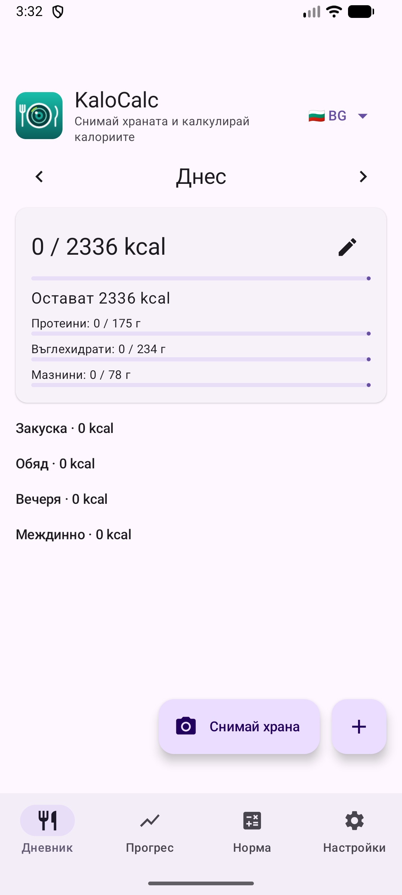
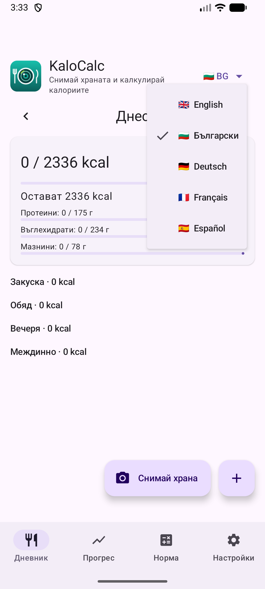

# 1. Първо стартиране и език

Какво виждаш при първото отваряне на KaloCalc и как да смениш езика.

**Предусловия:** Няма. Приложението е безплатно и работи без акаунт.

## Стъпки

1. Отвори KaloCalc. Началният екран е **Дневник**: празен ден, дневната норма (калории и макроси) и четирите хранения.

   

2. Горе вдясно натисни езика („🇧🇬 BG ▾“). Избери английски, български, немски, френски или испански. Целият интерфейс се превежда веднага и изборът се запомня.

   

## Резултат

Първия път приложението взема езика на телефона, ако е един от петте, иначе английски.

---

[Към съдържанието](../../README.md#съдържание) · [Напред →](02-calculator-daily-norm.md)
