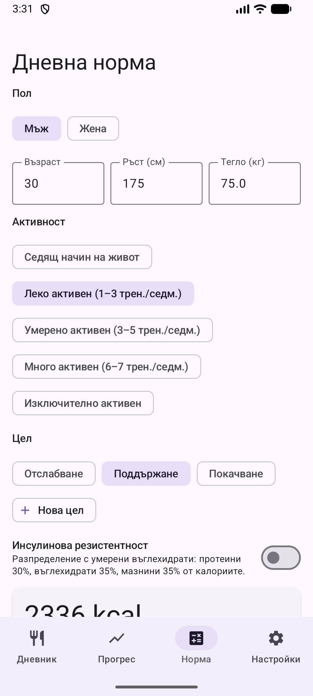

# 2. Дневна норма (калкулатор)

Изчисляване на препоръчителния дневен прием на калории и макроси.

**Предусловия:** Няма.

## Стъпки

1. Отвори таб **Норма**. Въведи пол, възраст, ръст и тегло.

   

2. Избери активност и цел (отслабване, поддържане, покачване). Може да добавиш своя цел с **Нова цел** и да включиш разпределение за инсулинова резистентност.

   

3. Прегледай резултата (BMR, TDEE, протеини, въглехидрати, мазнини) и натисни **Запази профила**.

## Резултат

Нормата се показва в Дневника и се следва от графиките в Прогрес. Формулата е Mifflin-St Jeor. Това е приблизителна оценка, не медицински съвет.

---

[← Назад](01-first-start.md) · [Към съдържанието](../../README.md#съдържание) · [Напред →](03-diary-add-manually.md)
