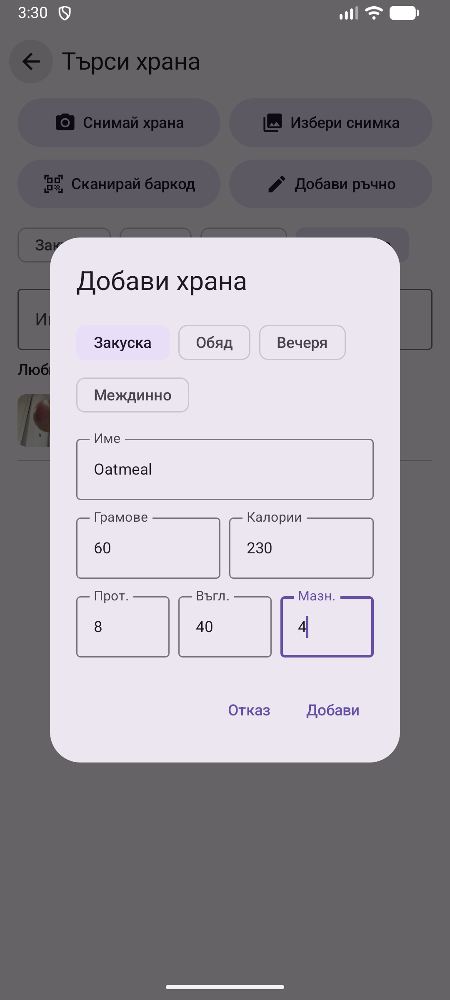
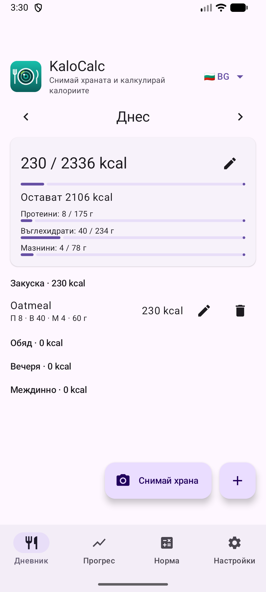

# 3. Добавяне на храна ръчно

Записване на ястие в дневника с име, грамаж, калории и макроси.

**Предусловия:** Няма.

## Стъпки

1. В Дневника натисни **+**. Избери **Добави ръчно**.

   

2. Избери хранене, въведи име, грамове, калории и протеини, въглехидрати, мазнини. Полето се маркира целия при докосване, така че можеш веднага да пишеш отгоре.

   

3. Натисни **Добави**. Записът се появява под храненето, а сборът и остатъкът за деня се обновяват.

   

## Видео

[▶ Гледай видеото](../../media/03-diary-add-manually/bg-demo.mp4)

## Резултат

Молив редактира записа, кошче го изтрива.

---

[← Назад](02-calculator-daily-norm.md) · [Към съдържанието](../../README.md#съдържание) · [Напред →](04-search-and-barcode.md)
