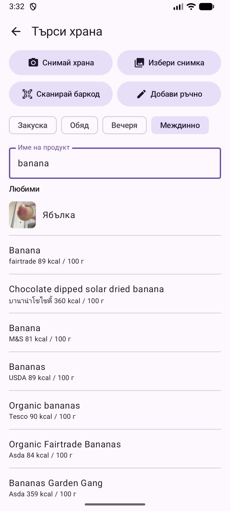
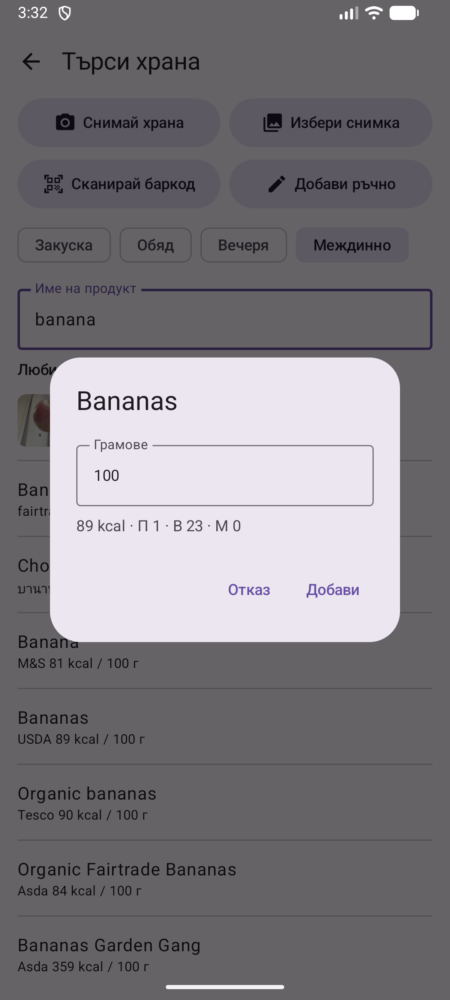

# 4. Търсене на храна и баркод

Намиране на продукт в Open Food Facts по име или баркод и добавяне с грамаж.

**Предусловия:** Интернет връзка.

## Стъпки

1. Натисни **+** в Дневника. Избери хранене и пиши името в полето **Име на продукт**. Любимите ти продукти са под полето.

   

2. Избери продукт от резултатите. Всеки ред показва калориите на 100 г.

   

3. Въведи грамажа. Калориите и макросите се изчисляват. Натисни **Добави**.

   

4. За баркод натисни **Сканирай баркод** и насочи камерата към кода на опаковката.

## Резултат

Ако търсенето намери малко или нищо и имаш Gemini ключ, приложението го превежда на френски, търси отново и връща резултатите на твоя език.

> **Липсва:** Снимка на сканирането на баркод (нужна е камера).

---

[← Назад](03-diary-add-manually.md) · [Към съдържанието](../../README.bg.md#съдържание) · [Напред →](05-photo-offline-labels.md)
