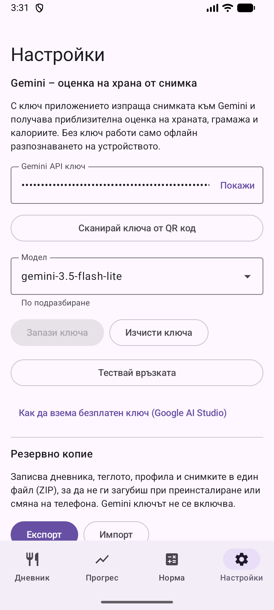

# 10. Настройки: Gemini ключ и Health Connect

Въвеждане на Gemini ключ, избор на модел и интеграция с Health Connect.

**Предусловия:** За ключ: акаунт в Google AI Studio.

## Стъпки

1. Отвори **Настройки**. Постави ключа или го сканирай от QR код, избери модел и натисни **Запази ключа**. **Тествай връзката** проверява ключа и модела. Линкът отдолу води към Google AI Studio за безплатен ключ.

   

2. По-надолу: **Health Connect** записва добавената храна за други приложения и може да коригира целта според изгорените калории.

   

## Резултат

Без ключ приложението работи само с офлайн етикетите. Ключът се пази само на телефона.

---

[← Назад](09-backup-export-import.md) · [Към съдържанието](../../README.md#съдържание)
