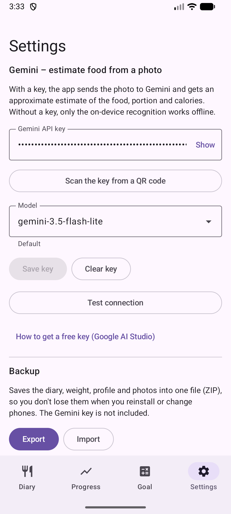

# 10. Einstellungen: Gemini-Schlüssel und Health Connect

Gemini-Schlüssel eintragen, ein Modell wählen und Health Connect einrichten.

**Voraussetzungen:** Für den Schlüssel: ein Google-AI-Studio-Konto.

## Schritte

1. Öffne die **Einstellungen**. Füge den Schlüssel ein oder scanne ihn aus einem QR-Code, wähle ein Modell und tippe auf **Schlüssel speichern**. **Verbindung testen** prüft Schlüssel und Modell. Wie du einen Schlüssel bekommst, steht weiter unten.

   

2. Weiter unten: **Health Connect** schreibt das hinzugefügte Essen für andere Apps und kann das Ziel anhand der verbrannten Kalorien anpassen.

   

## Ergebnis

Ohne Schlüssel arbeitet die App nur mit den Offline-Labels. Der Schlüssel wird nur auf dem Handy gespeichert.

## So bekommst du einen Gemini-Schlüssel

Öffne [aistudio.google.com/api-keys](https://aistudio.google.com/api-keys) in einem Browser. Jeder Browser funktioniert (Chrome, Firefox, Edge, Safari, Samsung Internet), auf dem Handy oder am Computer. Der Schlüssel ist eine lange Zeichenfolge, die mit `AIza` beginnt. Er ist kostenlos und braucht keine Bankkarte. Hast du Google AI Studio schon einmal benutzt, landest du direkt in der Liste der Schlüssel.

### Du bist nicht bei Google angemeldet (oder nutzt nicht Chrome)

1. Die Seite leitet dich zur Anmeldung weiter. Gib E-Mail und Passwort deines privaten Google-Kontos (Gmail) ein. Hast du keines, erstelle eines mit „Konto erstellen“.
2. Ist der Browser nicht Chrome, ändert sich nichts: Du meldest dich auf der Seite von Google an, nicht im Browser.
3. Beim ersten Besuch erscheint ein Dialog mit den Nutzungsbedingungen. Setze das Häkchen und akzeptiere ihn, sonst geht die Seite nicht weiter.

### Du hast mehr als ein Konto

1. Sieh dir das runde Symbol (Foto oder Buchstabe) oben rechts an. Es zeigt, mit welchem Konto du angemeldet bist.
2. Ist es nicht das gewünschte, tippe auf das Symbol und wähle ein anderes Konto oder „Weiteres Konto hinzufügen“.
3. Meldet der Browser dich immer wieder mit dem falschen (zum Beispiel dienstlichen) Konto an, öffne die Seite in einem Inkognito-/privaten Fenster und melde dich nur mit dem gewünschten Konto an.
4. Dienst- und Schulkonten (Google Workspace) sind oft vom Administrator gesperrt. Nimm ein privates Konto.
5. Schlüssel gehören zu einem Konto. Ein mit einem Konto erstellter Schlüssel ist von einem anderen aus nicht sichtbar.

### Du hast keinen Schlüssel: erstellen

1. Tippe auf der Seite **API keys** auf **Create API key**.
2. Es fragt nach einem Google-Cloud-Projekt. Hast du schon eines, wähle es aus der Liste. Wenn nicht, wähle, ein neues Projekt zu erstellen. Der Name spielt keine Rolle.
3. Der Schlüssel erscheint in der Liste. Kopiere ihn (das Kopiersymbol neben dem Schlüssel oder den Schlüssel öffnen und dort kopieren).
4. Siehst du die Meldung, dass es keine Projekte gibt, wähle zuerst die Option, ein Projekt zu erstellen oder zu importieren, und wiederhole dann Schritt 1.

### Du hast schon einen Schlüssel: wo du ihn findest

1. Dieselbe Liste **API keys** zeigt alle Schlüssel des Kontos mit Name, Projekt und Erstellungsdatum.
2. Tippe auf die Zeile des Schlüssels, um ihn ganz zu sehen und zu kopieren. Wird nur ein Teil angezeigt (`AIza...xxxx`), öffne seine Details.
3. Keine Schlüssel in der Liste? Wahrscheinlich bist du mit einem anderen Konto angemeldet. Wechsle es (siehe oben). Ist der Schlüssel wirklich weg oder weißt du nicht mehr, wo er ist, erstelle einen neuen; der alte schadet nicht.
4. Gib den Schlüssel nicht weiter und zeige ihn nicht auf Screenshots. Wer ihn hat, verbraucht dein Kontingent.

### So trägst du ihn in die App ein

- Auf dem Handy: kopiere den Schlüssel, öffne die **Einstellungen** in der App, füge ihn ein und tippe auf **Schlüssel speichern**.
- Am Computer: schicke dir den Schlüssel selbst (zum Beispiel in einer Nachricht an dich) und kopiere ihn auf dem Handy, oder zeige ihn als QR-Code an und scanne ihn in der App.
- Tippe zum Schluss auf **Verbindung testen**. Ein grünes Ergebnis bedeutet, dass der Schlüssel funktioniert.

---

[← Zurück](09-backup-export-import.md) · [Zum Inhalt](../../README.de.md#inhalt)
