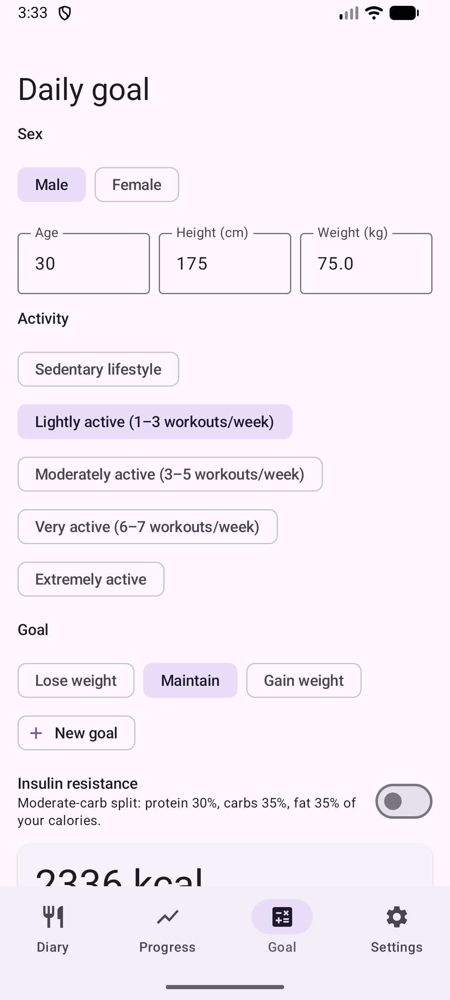
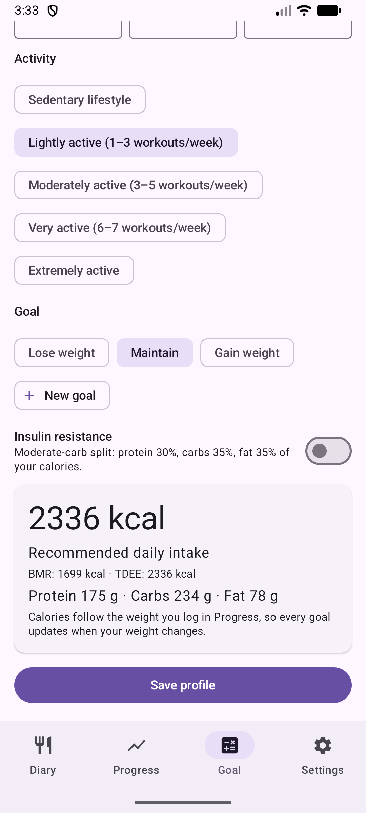

# 2. Daily goal (calculator)

Work out the recommended daily intake of calories and macros.

**Prerequisites:** None.

## Steps

1. Open the **Goal** tab. Enter sex, age, height and weight.

   

2. Pick activity and goal (lose, maintain, gain). Add your own goal with **New goal** and optionally turn on the insulin-resistance split.

   

3. Check the result (BMR, TDEE, protein, carbs, fat) and tap **Save profile**.

## Result

The goal shows in the Diary and drives the Progress charts. The formula is Mifflin-St Jeor. It is an estimate, not medical advice.

---

[← Previous](01-first-start.md) · [Back to contents](../../README.md#contents) · [Next →](03-diary-add-manually.md)
