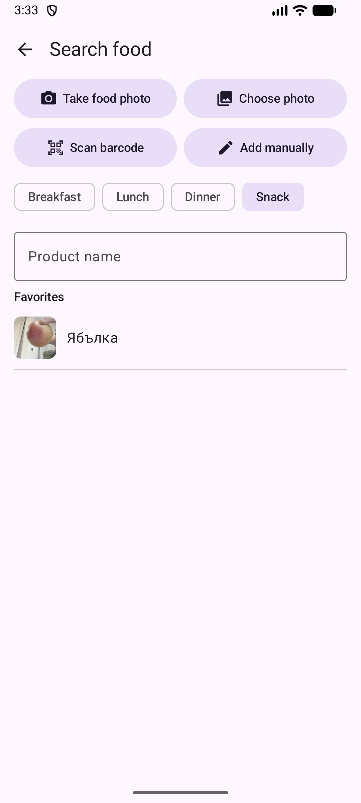
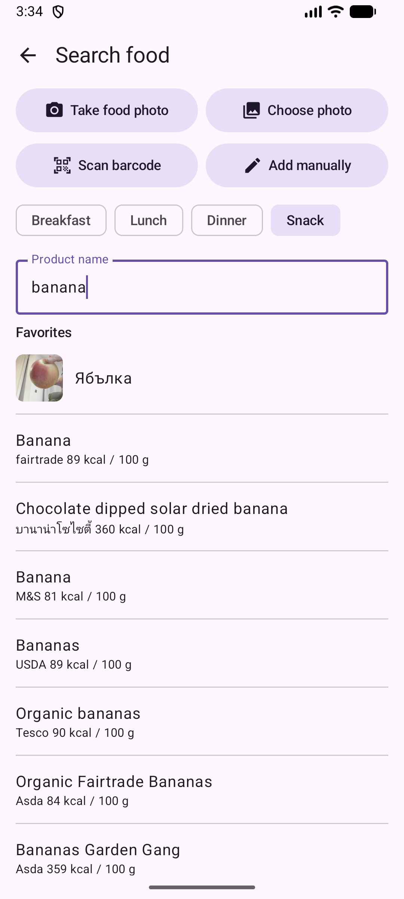
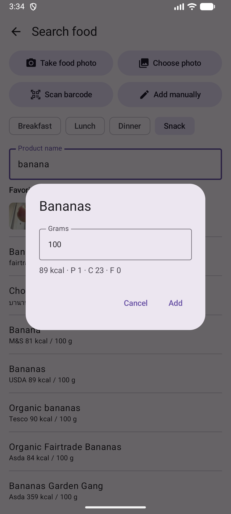

# 4. Buscar comida y código de barras

Encuentra un producto en Open Food Facts por nombre o código de barras y añádelo con una ración.

**Requisitos:** Conexión a internet.

## Pasos

1. Toca **+** en el Diario. Elige la comida y escribe el nombre en **Nombre del producto**. Tus favoritos aparecen bajo el campo.

   

2. Elige un producto de los resultados. Cada fila muestra las calorías por 100 g.

   

3. Introduce los gramos. Las calorías y los macros se calculan. Toca **Añadir**.

   

4. Para un código de barras toca **Escanear código de barras** y apunta la cámara al código del envase.

## Resultado

Si una búsqueda encuentra poco o nada y tienes una clave de Gemini, la aplicación la traduce al francés, vuelve a buscar y devuelve los resultados en tu idioma.

> **Falta:** Captura del escaneo del código de barras (necesita una cámara).

---

[← Anterior](03-diary-add-manually.md) · [Volver al contenido](../../README.es.md#contenido) · [Siguiente →](05-photo-offline-labels.md)
