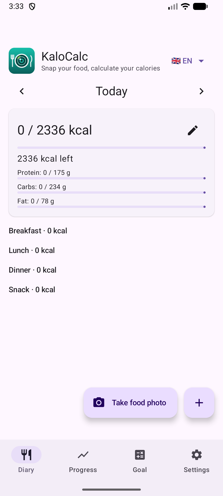
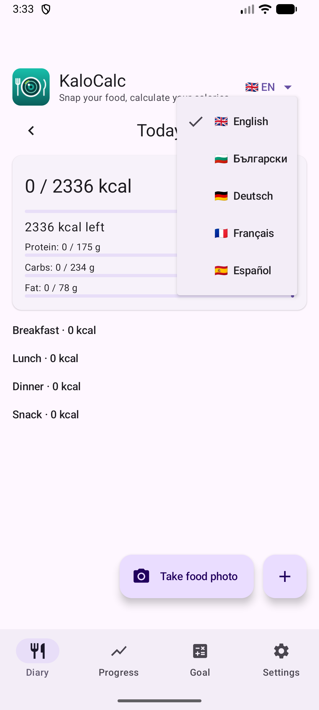

# 1. Premier démarrage et langue

Ce que vous voyez à la première ouverture de KaloCalc et comment changer la langue.

**Prérequis :** Aucun. L'application est gratuite et ne demande pas de compte.

## Étapes

1. Ouvrez KaloCalc. L'écran d'accueil est le **Journal** : une journée vide, l'objectif quotidien (calories et macros) et les quatre repas.

   

2. Touchez la langue (« 🇬🇧 EN ▾ ») en haut à droite. Choisissez anglais, bulgare, allemand, français ou espagnol. Toute l'interface change aussitôt et le choix est mémorisé.

   

## Résultat

Au premier lancement, l'application suit la langue du téléphone si elle fait partie des cinq, sinon l'anglais.

---

[Retour au sommaire](../../README.fr.md#sommaire) · [Suivant →](02-calculator-daily-norm.md)
