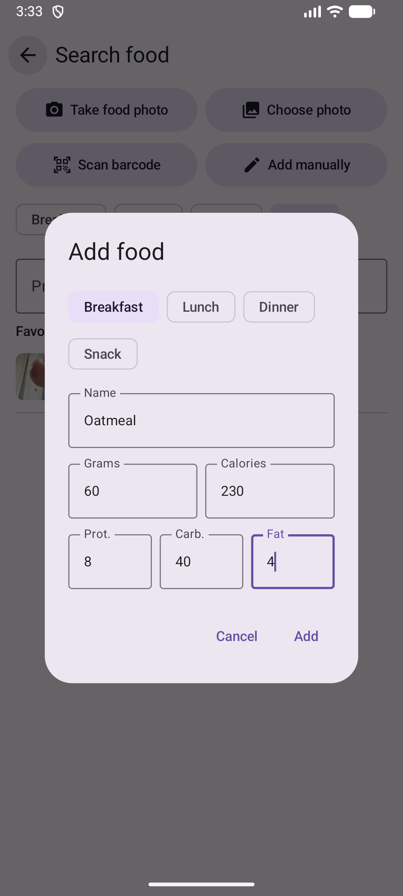
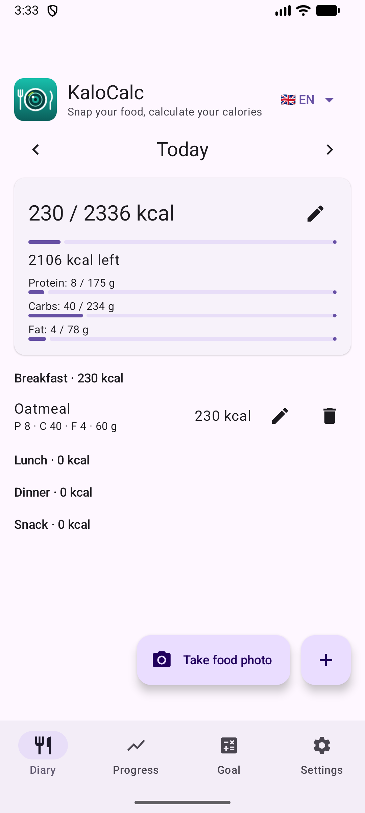

# 3. Ajouter un aliment manuellement

Enregistrez un repas dans le journal avec son nom, les grammes, les calories et les macros.

**Prérequis :** Aucun.

## Étapes

1. Dans le Journal, touchez **+**. Choisissez **Ajouter manuellement**.

   

2. Choisissez le repas, saisissez le nom, les grammes, les calories, puis les protéines, glucides et lipides. Toucher un champ sélectionne toute sa valeur, vous pouvez donc taper directement par-dessus.

   

3. Touchez **Ajouter**. L'entrée apparaît sous le repas, et le total du jour et le reste sont mis à jour.

   

## Vidéo

[▶ Regarder la vidéo](../../media/03-diary-add-manually/bg-demo.mp4)

_La vidéo a été enregistrée avec l'interface en bulgare._

## Résultat

Le crayon modifie une entrée, la corbeille la supprime.

---

[← Précédent](02-calculator-daily-norm.md) · [Retour au sommaire](../../README.fr.md#sommaire) · [Suivant →](04-search-and-barcode.md)
