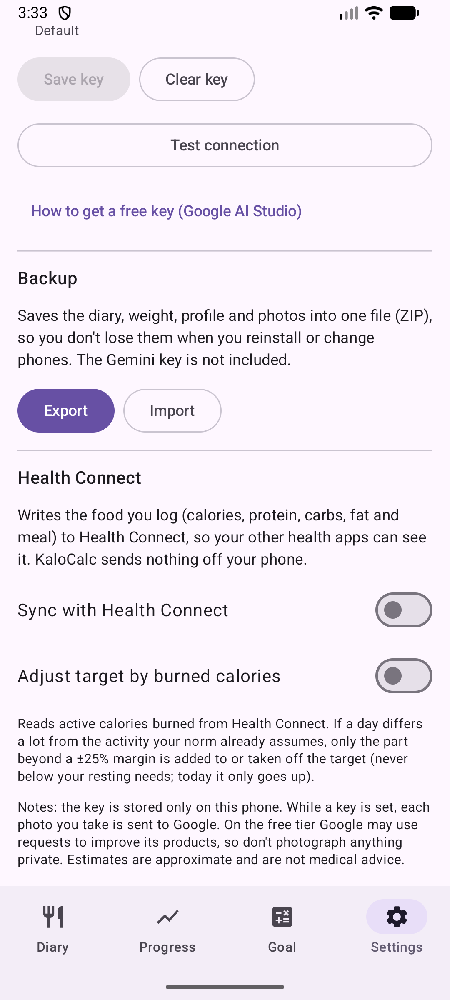

# 9. Sauvegarde : export et import

Enregistrez toutes les données dans un fichier ZIP et récupérez-les.

**Prérequis :** Aucun.

## Étapes

1. Ouvrez les **Réglages** et faites défiler jusqu'à **Sauvegarde**.

   

2. **Exporter** enregistre le journal, le poids, le profil et les photos dans un fichier ZIP via le sélecteur de fichiers du système. La clé Gemini n'est pas incluse.
3. **Importer** restaure les données depuis un tel fichier. Cela REMPLACE tout après confirmation et le fichier est d'abord vérifié.

## Résultat

Les données sont sur le téléphone et sont perdues en cas de désinstallation ou de changement de téléphone : exportez de temps en temps.

> **Manquant :** Captures d'écran du sélecteur de fichiers et de la confirmation d'import.

---

[← Précédent](08-progress-charts.md) · [Retour au sommaire](../../README.fr.md#sommaire) · [Suivant →](10-language-and-settings.md)
